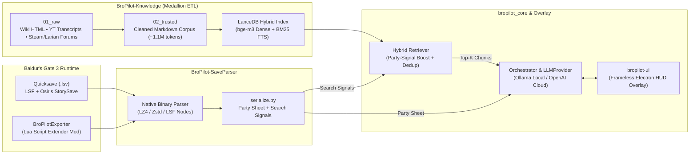

# 🎲 BroPilot — Real-Time AI Co-Pilot for Baldur's Gate 3


**BroPilot** is a state-aware AI tactical assistant and overlay for **Baldur's Gate 3**. It combines native binary save-file parsing (`.lsv` / LSF / Osiris StorySave), a Lua Script Extender companion mod, and a hybrid Retrieval-Augmented Generation (RAG) pipeline to deliver real-time min-maxing advice, action-economy optimization, equipment synergy, and dialogue guidance directly over the game.

---

## 🏗️ System Architecture

Unlike generic wiki chatbots, BroPilot is **state-aware**: your active party's state enters the pipeline twice—first as structured search signals that steer hybrid vector/FTS retrieval, and second as serialized character sheets injected into the generation prompt.



### The Four Subsystems

| Subsystem | Description |
| :--- | :--- |
| **`BroPilot-SaveParser`** | Native Python binary parser that unpacks Larian `.lsv` packages (LZ4/Zstd) and parses `Globals.lsf`, `meta.lsf`, and Osiris `StorySave.bin` databases without external C# tools, paired with a Lua Script Extender mod (`BroPilotExporter`) for live combat/inventory snapshots. |
| **`BroPilot-Knowledge`** | Medallion-architecture ETL pipeline (`01_raw` → `02_trusted` → `03_refined`) that crawls and sanitizes the BG3 Wiki, Larian Forums, Steam Community build guides, YouTube build transcripts, and dialogue trees (`dialog.moxifer.com`). |
| **`bropilot_core`** | The state-aware RAG engine. Indexes the 1.1M-token Markdown corpus into **LanceDB** using `bge-m3` embeddings + full-text search, extracts party signals (`extract_signals`), performs hybrid retrieval with source deduplication, and abstracts generation behind `LLMProvider` (local Ollama or cloud OpenAI). |
| **`bropilot-ui`** | Frameless, always-on-top **Electron** overlay summoned via global hotkey (`Ctrl+Shift+B`) that communicates with the Python orchestrator subprocess to answer tactical queries mid-combat. |

---

## 🎯 Empirical RAG Accuracy Benchmark

BroPilot was evaluated against a 10-question adversarial benchmark executed against the real hybrid index and a live party save file—intentionally covering edge cases in BG3's D&D 5e ruleset (action economy, feat interactions, multiclass spell slots, and item synergies). Verdicts were scored blind by a stronger external judge model across five controlled single-variable runs:

| Run | Generation Model | Embedding Model | ✅ Pass | 🟡 Partial | ❌ Fail | Weighted Score | Avg Latency |
| :--- | :--- | :--- | :---: | :---: | :---: | :---: | :---: |
| 1 (Baseline) | `qwen2.5:7b` (Local) | `bge-m3` (Local) | 2 | 3 | 5 | **3.5 / 10** | ~60s |
| 2 | `qwen2.5:14b` (Local) | `bge-m3` (Local) | 1 | 5 | 4 | **3.5 / 10** | ~107s |
| 3 | `qwen2.5:7b` (`temp=0`) | `bge-m3` (Local) | 1 | 4 | 5 | **3.0 / 10** | ~54s |
| 4 | `qwen2.5:14b` (`temp=0`) | `bge-m3` (Local) | 2 | 4 | 4 | **4.0 / 10** | ~130s |
| **5 (Final)** | **`gpt-4o-mini` (`temp=0`)** | **`bge-m3` (Local)** | **9** | **1** | **0** | **9.5 / 10** | **~8s** |

### Key Engineering Takeaways
1. **The Retrieval Pipeline Was Always Right:** Across all 5 runs, the state-aware hybrid retriever surfaced the exact subclass tables and item mechanics, and the binary parser accurately extracted party levels, classes, and attributes.
2. **Quantized Local Models Bottlenecked Rule Synthesis:** Quantized `7b`/`14b` local models hallucinated D&D 5e rule interactions when synthesizing multi-chunk builds (e.g., applying *Great Weapon Master* to unarmed strikes). Neither doubling model parameters nor pinning `temperature=0` eliminated rule fabrication.
3. **Hybrid Local-Index + Cloud-Generation Sweet Spot:** Keeping embeddings (`bge-m3`) and vector search (`LanceDB`) 100% local while routing final synthesis through `gpt-4o-mini` eliminated rule hallucinations (**9.5/10**), cut latency by **10×**, and costs **~$0.038/user/month** (~40 queries/month). Both backends remain selectable via `LLMProvider`.

📋 Detailed evaluation logs: [`docs/ACCURACY_TRACKING.md`](docs/ACCURACY_TRACKING.md) · [`docs/ACCURACY_REPORT.md`](docs/ACCURACY_REPORT.md) · [`docs/ACCURACY_REPORT_gpt4omini_temp0.md`](docs/ACCURACY_REPORT_gpt4omini_temp0.md)

---

## 📁 Repository Structure

```text
BroPilot/
├── bropilot_core/                # State-Aware RAG & LLM Orchestration Engine
│   ├── index/
│   │   ├── build.py              # Markdown chunker & LanceDB indexer (bge-m3)
│   │   └── retriever.py          # State-aware hybrid search (Dense + BM25 + Dedup)
│   ├── scripts/                  # Retrieval & RAG benchmark harnesses (eval_rag.py)
│   ├── tests/                    # Unit test suite (LLM providers, serializer, retriever)
│   ├── cli.py                    # Interactive terminal REPL & JSON subprocess entrypoint
│   ├── llm.py                    # LLMProvider abstraction (OllamaProvider & OpenAIProvider)
│   ├── orchestrator.py           # Prompt assembly & token budget management
│   └── serialize.py              # SaveContext -> character sheets & retrieval signals
├── BroPilot-SaveParser/          # Native .lsv Save Unpacker & LSF/Osiris Parser
│   ├── exporter/                 # Lua Script Extender mod (BroPilotExporter)
│   ├── scripts/                  # CLI save inspection & debugging utilities
│   └── src/bropilot/             # LSF binary reader, StorySave parser, and party extractor
├── BroPilot-Knowledge/           # Medallion ETL Pipeline (Knowledge Base)
│   ├── data/
│   │   ├── 01_raw/               # Raw HTML dumps & transcripts
│   │   ├── 02_trusted/           # Sanitized Markdown corpus (119 files, ~4.5 MB)
│   │   └── 03_refined/           # Structured JSON matrices & dialogue indices
│   └── scripts/                  # Wiki, Larian Forum, Steam Guide & YouTube scrapers/cleaners
├── bropilot-ui/                  # Frameless Electron In-Game Overlay
│   ├── electron-main.js          # Global hotkey listener, transparent window & Python IPC
│   └── src/renderer.js           # HUD interface & streaming response renderer
└── docs/                         # Accuracy reports, architecture notes & evaluation logs
```

---

## 🚀 Getting Started

### 1. Prerequisites
- **Python 3.11+**
- **Node.js 18+** (for the Electron overlay)
- **Ollama** with `bge-m3` pulled (`ollama pull bge-m3`) for local vector embeddings
- Either a local generation model (`ollama pull qwen2.5:7b-instruct-q4_K_M`) or an `OPENAI_API_KEY` environment variable

### 2. Installation
```bash
# Install Python dependencies
pip install -r requirements.txt

# InstallSaveParser package in editable mode
pip install -e BroPilot-SaveParser

# Build the local LanceDB vector index (run once with Ollama active)
python -m bropilot_core.index.build
```

### 3. Running the CLI or In-Game Overlay
```bash
# Option A: Interactive terminal REPL
python -m bropilot_core.cli

# Option B: Launch the Electron HUD Overlay (toggle in-game with Ctrl+Shift+B)
cd bropilot-ui
npm install
npm start
```

### 4. Running Tests
```bash
python -m unittest discover -s bropilot_core/tests -v
```
